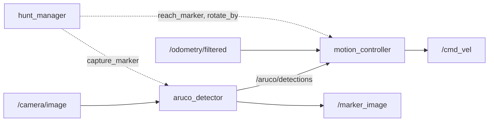
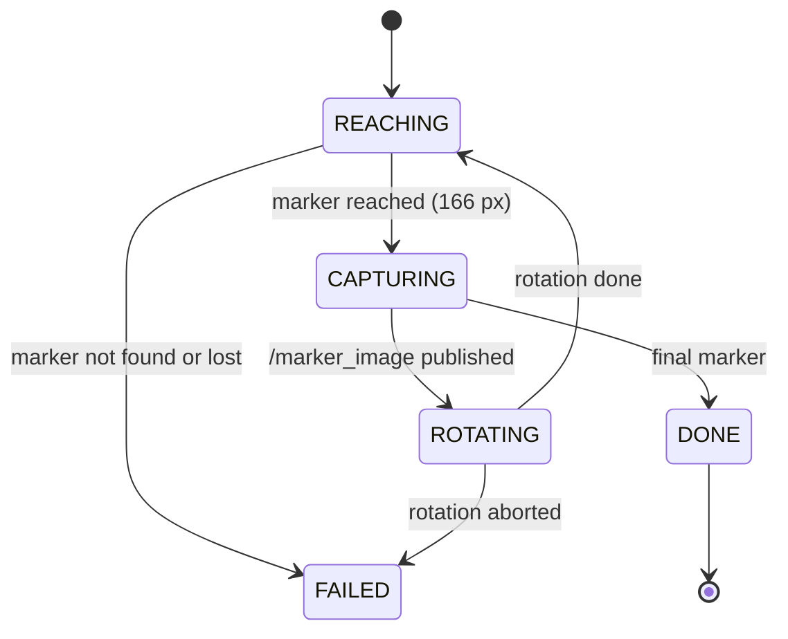

# ArUco Treasure Hunt

Experimental Robotics Laboratory, Assignment 1 (UniGe, 2026/27).

A differential-drive robot follows four ArUco markers. It reaches each marker with image-based
visual servoing, publishes the marker image on `/marker_image`, executes the marker's instruction
with a closed-loop rotation on odometry, and stops at marker 4. The same code runs in Gazebo and
on the ROSbot; only the parameter file changes.

## Requirements

- Ubuntu 22.04 + ROS 2 Humble, or Ubuntu 24.04 + ROS 2 Jazzy
- Gazebo Harmonic
- The course package [erl1](https://github.com/CarmineD8/erl1)

```bash
# Humble (Gazebo Harmonic from packages.osrfoundation.org)
sudo apt install ros-humble-ros-gzharmonic ros-humble-robot-localization ros-humble-xacro \
  ros-humble-cv-bridge ros-humble-image-transport-plugins ros-humble-rqt-image-view libopencv-dev
# Jazzy
sudo apt install ros-jazzy-ros-gz ros-jazzy-robot-localization ros-jazzy-xacro \
  ros-jazzy-cv-bridge ros-jazzy-image-transport-plugins ros-jazzy-rqt-image-view libopencv-dev
```

## Build

```bash
mkdir -p ~/exprob_ws/src && cd ~/exprob_ws/src
git clone https://github.com/Cb-dotcom/aruco_treasure_hunt_ExpRob1.git aruco_treasure_hunt
git clone https://github.com/CarmineD8/erl1.git
mkdir -p ~/gazebo_models && cp -r erl1/models/. ~/gazebo_models/  
cd ~/exprob_ws && colcon build --symlink-install && source install/setup.bash
```

## Run

### Simulation

Terminal 1:
```bash
ros2 launch treasure_hunt_bringup simulation.launch.py    # Gazebo, bridge, EKF, RViz
```
Terminal 2:
```bash
ros2 launch treasure_hunt_bringup treasure_hunt.launch.py # Let the hunt begin
```
Terminal 3: 
```bash
ros2 run rqt_image_view rqt_image_view /marker_image # Image check on viewer
```

ROSbot (`ROS_DOMAIN_ID` 10, 11 or 12 for rosbot 1, 2 or 3):
```bash
export ROS_DOMAIN_ID=10
ros2 launch treasure_hunt_bringup treasure_hunt.launch.py robot:=rosbot
```

## Architecture

Package layout: `treasure_hunt` (C++ components), `treasure_hunt_interfaces` (messages, service,
actions), `treasure_hunt_bringup` (launch files and parameters).

| Node | Role | Interfaces |
|---|---|---|
| `aruco_detector` | Perception | sub image (image_transport) → pub `/aruco/detections`; srv `capture_marker` → pub `/marker_image` |
| `motion_controller` | Motion, the only node publishing `/cmd_vel` | actions `reach_marker`, `rotate_by`; sub `/aruco/detections`, `/odometry/filtered`, `/camera/camera_info` |
| `hunt_manager` | Mission state machine | clients of `reach_marker`, `rotate_by`, `capture_marker` |



### State machine (`hunt_manager`)



Marker instructions are parameters (`config/sim.yaml`, `config/rosbot.yaml`):

| Marker | Instruction |
|---|---|
| 1 | turn right 90°, go ahead |
| 2 | turn 180°, go ahead |
| 3 | turn left 90°, go ahead |
| 4 | treasure found, stop |

### Motion behaviours (`motion_controller`)

Notation: $u$ is the column (px) of the marker centre, $c_x$ the image centre column, $s$ the
marker side (px) and $s_d$ the side at which the robot stops. The numbers below are the simulation
values; gains and tolerances are parameters in the same config files.

#### `reach_marker`: find the next marker and stop in front of it

1. **Search.** Drive straight ahead until a marker that has not been done yet appears near the
   image centre, i.e. $\lvert u - c_x \rvert < 120$ px.
2. **Visual servoing.** Turn to keep the marker centred and drive forward until it looks as big as $s_d$:

$$
\omega = -k_\omega \, (u - c_x)
\qquad\qquad
v =
\begin{cases}
k_v \, (s_d - s) & \text{if } \lvert u - c_x \rvert < 60 \text{ px} \\
0 & \text{otherwise (centre it first)}
\end{cases}
$$

3. **Done** when $\lvert s_d - s \rvert < 4$ px and $\lvert u - c_x \rvert < 10$ px.
4. **Missed frames.** If a frame misses the marker but it was last seen ahead, the robot keeps its
   last command (far markers are not detected in every frame). If the marker left the view, it
   turns towards it. If camera frames stop arriving, it stops.

#### `rotate_by`: turn in place by an angle $\theta$

The robot adds up the yaw increments from the odometry, $\Delta\psi$ (so 180° and 360° work), and turns with

$$
\omega = k_\psi \, (\theta - \Delta\psi)
$$

until $\lvert \theta - \Delta\psi \rvert < 0.02$ rad, never slower than 0.1 rad/s so it does not stall.
Positive $\theta$ turns left.

### Stop distance ($s_d$)

A camera with focal length $f_x$ (pixels) sees a marker of side $L$ at distance $d$ with side

$$
s = \frac{f_x \, L}{d}
$$

In simulation the image is 640 px wide with an 80° horizontal field of view, so

$$
f_x = \frac{320}{\tan 40^\circ} \approx 381.36 \text{ px}
\qquad\Rightarrow\qquad
s_d = 166 \text{ px} \;\Leftrightarrow\; d = \frac{381.36 \cdot 0.2}{166} \approx 0.46 \text{ m}
$$

(camera to marker). On the ROSbot the camera has another focal length $f_x'$, read from
`camera_info`, and the target is scaled so the robot stops at the same distance without retuning:

$$
s_d' = 166 \cdot \frac{f_x'}{381.36}
$$

## Contributors

| Name | GitHub | 
|---|---|
| Charbel El Beaini | [@Cb-dotcom](https://github.com/Cb-dotcom) | 
| Endri Gjinaj | [@egjinaj](https://github.com/egjinaj) |
| Joel Topuli | [@IloPinci](https://github.com/IloPinci) | 
| Reynald Awad | [@reyaouad](https://github.com/reyaouad) |


<a href="https://github.com/Cb-dotcom/aruco_treasure_hunt_ExpRob1/graphs/contributors">
  
</a>
