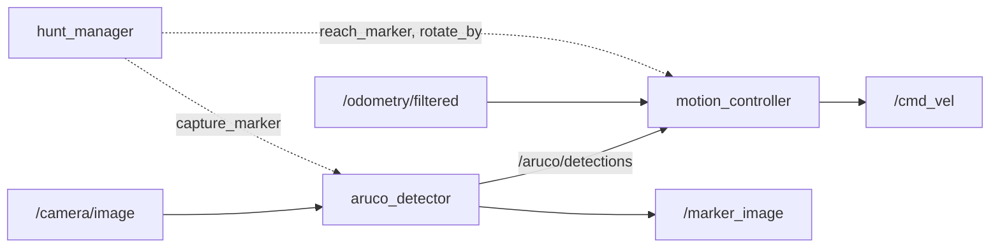
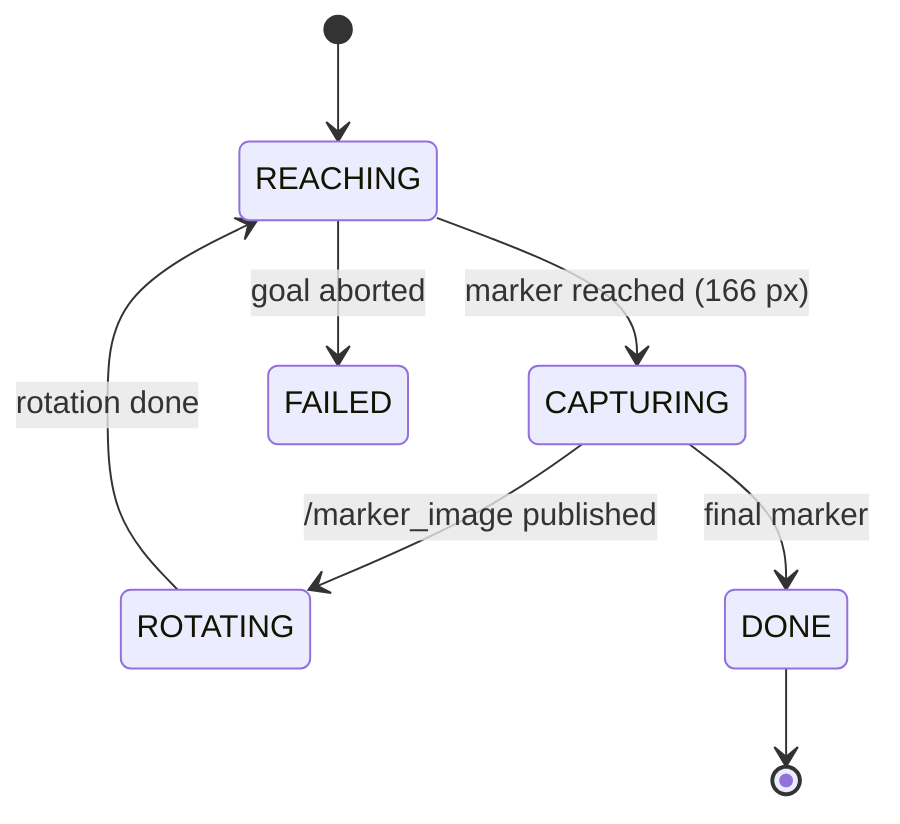

# ArUco Treasure Hunt

Experimental Robotics Laboratory, Assignment 1 (UniGe, 2026/27).

A differential-drive robot follows four ArUco markers. It reaches each marker with image-based
visual servoing, publishes the marker image on `/marker_image`, executes the marker's instruction
with a closed-loop rotation on odometry, and stops at marker 4. The same code runs in Gazebo and
on the ROSbot; only the parameter file changes.

## Requirements

- Ubuntu 22.04 + ROS 2 Humble, or Ubuntu 24.04 + ROS 2 Jazzy
- Gazebo Harmonic
- The course package [erl1](https://github.com/CarmineD8/erl1)

```bash
# Humble (Gazebo Harmonic from packages.osrfoundation.org)
sudo apt install ros-humble-ros-gzharmonic ros-humble-robot-localization ros-humble-xacro \
  ros-humble-cv-bridge ros-humble-image-transport-plugins ros-humble-rqt-image-view libopencv-dev
# Jazzy
sudo apt install ros-jazzy-ros-gz ros-jazzy-robot-localization ros-jazzy-xacro \
  ros-jazzy-cv-bridge ros-jazzy-image-transport-plugins ros-jazzy-rqt-image-view libopencv-dev
```

## Build

```bash
mkdir -p ~/exprob_ws/src && cd ~/exprob_ws/src
git clone https://github.com/Cb-dotcom/aruco_treasure_hunt_ExpRob1.git aruco_treasure_hunt
git clone https://github.com/CarmineD8/erl1.git
mkdir -p ~/gazebo_models && cp -r erl1/models/. ~/gazebo_models/   # aruco_box_* models
cd ~/exprob_ws && colcon build --symlink-install && source install/setup.bash
```

## Run

Simulation:
```bash
ros2 launch treasure_hunt_bringup simulation.launch.py    # Gazebo, bridge, EKF, RViz
ros2 launch treasure_hunt_bringup treasure_hunt.launch.py # in a second terminal
ros2 run rqt_image_view rqt_image_view /marker_image
```

ROSbot (`ROS_DOMAIN_ID` 10, 11 or 12 for rosbot 1, 2 or 3):
```bash
export ROS_DOMAIN_ID=10
ros2 launch treasure_hunt_bringup treasure_hunt.launch.py robot:=rosbot
```

## Architecture

| Node | Role | Interfaces |
|---|---|---|
| `aruco_detector` | Perception | sub image (image_transport) → pub `/aruco/detections`; srv `capture_marker` → pub `/marker_image` |
| `motion_controller` | Motion, the only node publishing `/cmd_vel` | actions `reach_marker`, `rotate_by`; sub `/aruco/detections`, `/odometry/filtered`, `/camera/camera_info` |
| `hunt_manager` | Mission state machine | clients of `reach_marker`, `rotate_by`, `capture_marker` |





Marker instructions are parameters (`config/sim.yaml`, `config/rosbot.yaml`):

| Marker | Instruction |
|---|---|
| 1 | turn right 90°, go ahead |
| 2 | turn 180°, go ahead |
| 3 | turn left 90°, go ahead |
| 4 | treasure found, stop |

Motion behaviours (gains and tolerances in the same files):

| Action | Behaviour |
|---|---|
| `reach_marker` | Go ahead until a new marker appears near the image centre, then image-based visual servoing: ω = −k_ω (u − c_x), v = k_v (s_d − s), moving forward only when roughly centred. Done when s ≈ s_d. If the marker is lost, turn towards where it was last seen. |
| `rotate_by` | Rotate in place by the requested angle, closed loop on the odometry yaw. |

s_d = 166 px in simulation (camera about 0.46 m from the marker). On another camera it is scaled by
f_x / 381.36 (pinhole model s = f·L/d), with f_x read from `camera_info`, so the stop distance stays
the same.

Package layout: `treasure_hunt` (C++ components), `treasure_hunt_interfaces` (messages, service,
actions), `treasure_hunt_bringup` (launch files and parameters).

## Team

| Name | GitHub |
|---|---|
| Charbel El Beaini | [@Cb-dotcom](https://github.com/Cb-dotcom) |
| | |
| | |
| | |
